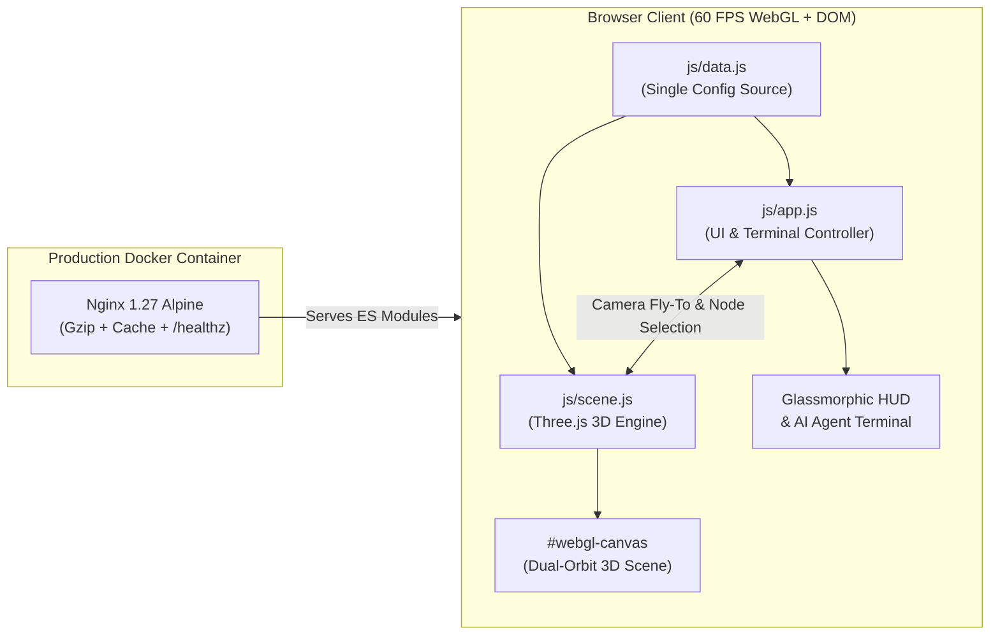

# 🌐 3D AI & Full-Stack Interactive Portfolio

An interactive, zero-bloat **3D WebGL Portfolio** built with **Three.js**, **GSAP**, and native **ES Modules**, containerized with **Docker & Nginx Alpine** for instant cloud or self-hosted deployment.

---

## 🏗️ System & Rendering Architecture



---

## ✨ Interactive Features

1. **Dual-Orbit 3D Neural Constellation (`js/scene.js`)**:
   - **Inner Orbit (AI & ML Ring)**: LLMs & Agentic AI, Hybrid RAG & Vector DBs, PyTorch & Fine-Tuning, Computer Vision & Multimodal AI, and AI Evals & Guardrails.
   - **Outer Orbit (Full-Stack & Cloud Ring)**: React 19 & Next.js, Three.js & WebGL, TypeScript & Node.js, Python & FastAPI, PostgreSQL/Redis/pgvector, and Docker/Kubernetes.
   - **Live Synaptic Data Packets**: Animated data signals travel along the 3D connections between your AI models, vector stores, backend APIs, and frontend UI.
2. **3D Raycasting & Camera Fly-To**:
   - Click any 3D crystal node (or its floating 3D label / skill card) to smoothly fly the camera to that skill and open the **3D Skill Inspector Drawer**.
   - Hop directly between connected technologies in the 3D graph.
3. **Project Architecture Visualizer**:
   - Click **"🌐 Visualize Stack in 3D"** on any project card to highlight the exact subset of AI and Full-Stack nodes powering that system.
4. **Interactive AI Agent Command Terminal**:
   - Run commands like `simulate-rag`, `skills --ai`, `skills --web`, `docker-status`, or type any technology name (`FastAPI`, `PyTorch`, `Docker`, `Three.js`) to trigger live 3D camera actions.
5. **Full 3D Free-Roam Mode**:
   - Click **"Full 3D Free-Roam"** in the top navbar to hide UI overlays and explore the 3D space freely (`Spacebar` triggers a Neural Pulse shockwave).

---

## 🚀 Quick Start & Deployment

### Option 1: Run with Docker Compose (Recommended for Production)

```bash
docker compose up -d --build
```

Then open **http://localhost:5500** in your browser.
- Healthcheck endpoint: `http://localhost:5500/healthz`
- Stop container: `docker compose down`

### Option 2: Build & Run with Docker CLI

```bash
docker build -t ai-3d-portfolio .
docker run -d -p 5500:80 --name portfolio ai-3d-portfolio
```

### Option 3: Local Preview (Without Docker)

Because the project uses native ES modules (`<script type="module">`) with zero `node_modules` bloat, serve the directory with any static HTTP server:

```bash
# Using Python
python -m http.server 5500 --bind 127.0.0.1

# Or using Node npx
npx serve -l 5500
```

---

## 🛠️ How to Customize Your Profile (`js/data.js`)

Open [`js/data.js`](./js/data.js) to customize everything in one place:
- **`profile`**: Your name, handle, role title, tagline, email, GitHub/LinkedIn links, and hero metrics.
- **`skills`**: Add, edit, or reorder 3D nodes, proficiency levels, colors, 3D geometries (`octahedron`, `icosahedron`, `dodecahedron`, `torusKnot`, `box`, `cylinder`), and neural `connections`.
- **`projects`**: Update your featured AI + Full-Stack projects and link them to `skillIds` for 3D visualization.
- **`experience`**: Update your career timeline and highlights.
